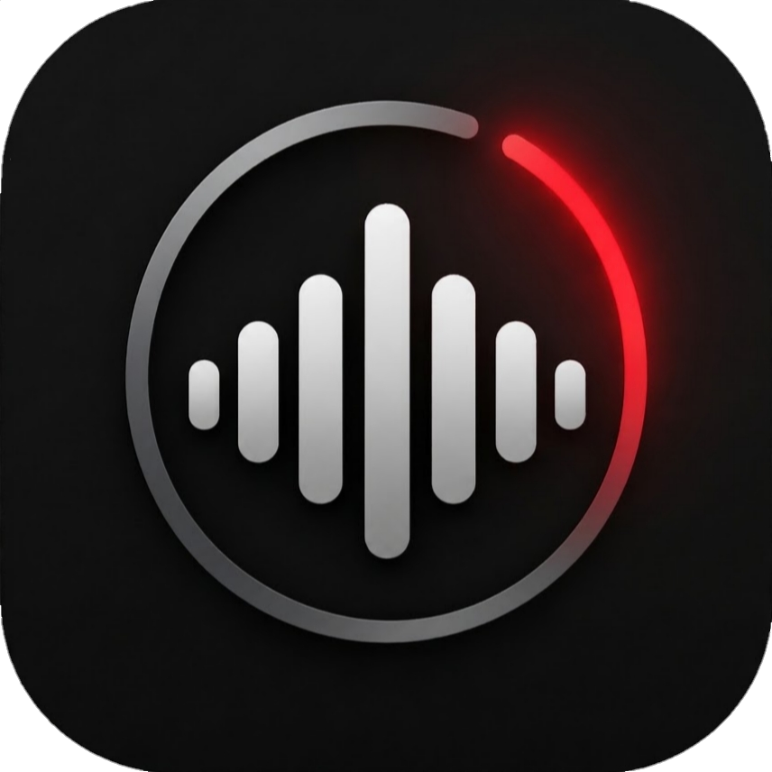
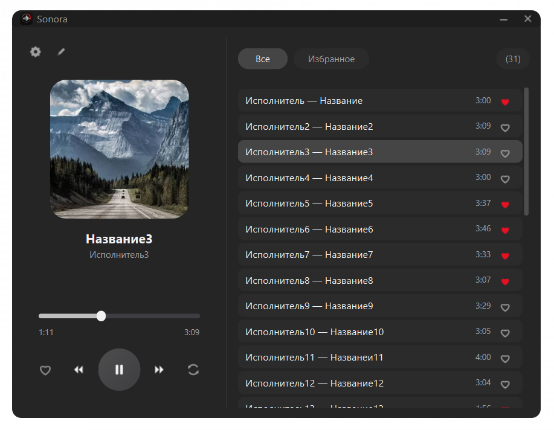
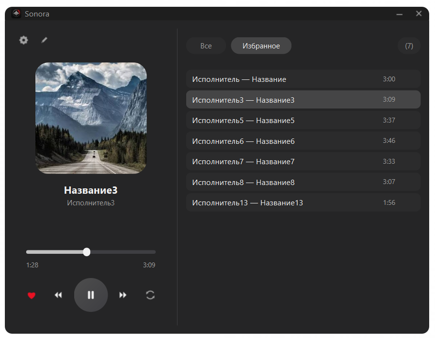
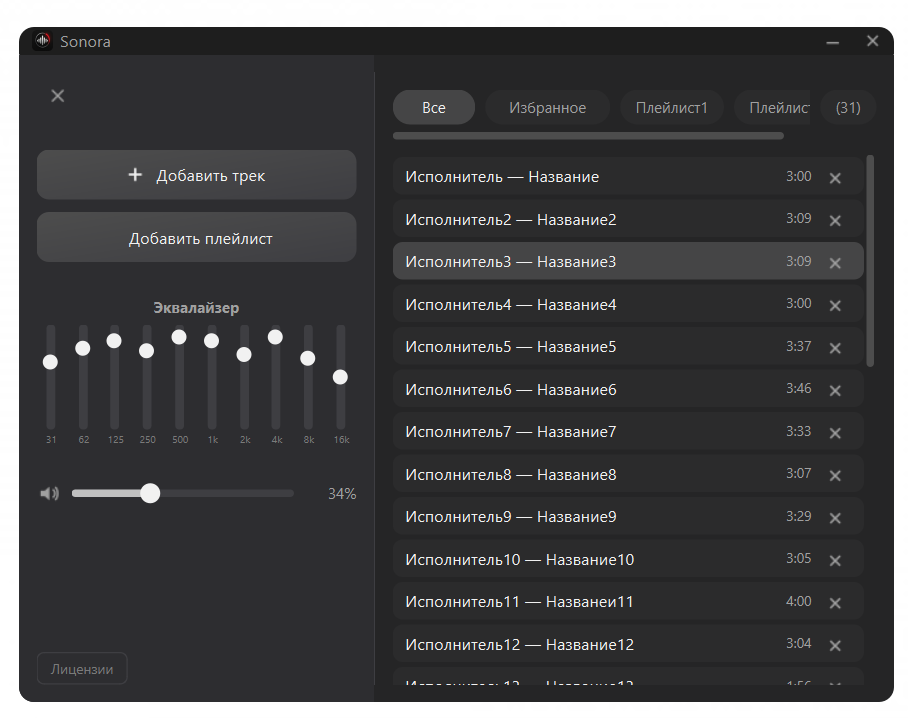
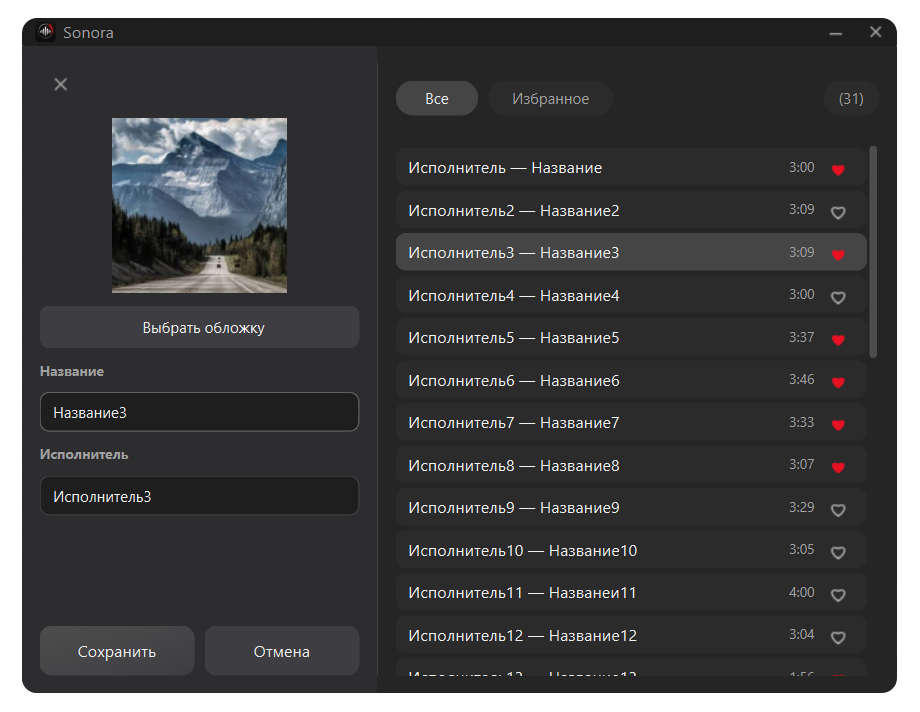
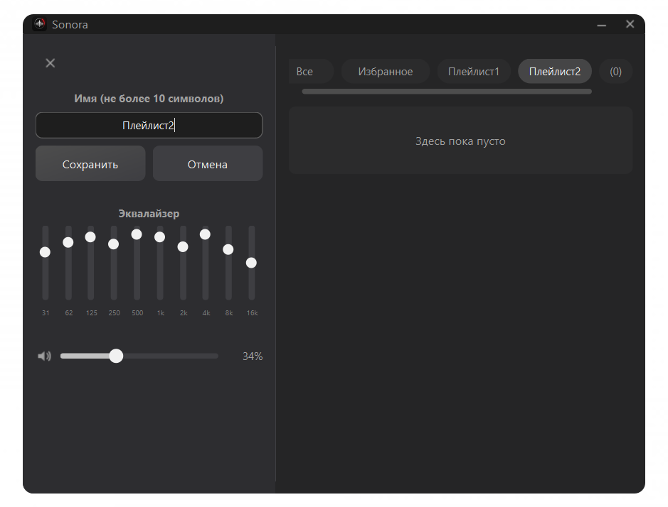

<div align="center">
  
  <h1>Sonora</h1>
  <p><b>Минималистичный музыкальный плеер на Qt 6</b><br/>
  Тёмная тема · безрамочное окно · собственные иконки · эквалайзер · теги ID3</p>

  <p>
    
    
    
    
    
    
  </p>

  <p>
    <a href="#-возможности">Возможности</a> ·
    <a href="#-скриншоты">Скриншоты</a> ·
    <a href="#-быстрый-старт">Быстрый старт</a> ·
    <a href="#-сборка-из-исходников">Сборка</a> ·
    <a href="#️-горячие-клавиши">Горячие клавиши</a> ·
    <a href="#-лицензия">Лицензия</a>
  </p>
</div>

---

## 📸 Скриншоты
<p align="center">
  
</p>
<p align="center"><i>Главное окно</i></p>

<table>
  <tr>
    <td width="50%">
      
      <p align="center"><i>Трек и «Избранное»</i></p>
    </td>
    <td width="50%">
      
      <p align="center"><i>Настройки: эквалайзер, громкость, лицензии</i></p>
    </td>
  </tr>
  <tr>
    <td width="50%">
      
      <p align="center"><i>Редактор трека: название, исполнитель, обложка</i></p>
    </td>
    <td width="50%">
      
      <p align="center"><i>Редактор плейлистов</i></p>
    </td>
  </tr>
</table>

---
## ✨ Возможности

| | |
|---|---|
| 🎨 **Свой интерфейс** | Безрамочное окно со скруглёнными углами, кастомная тёмная палитра, иконки, нарисованные вручную через `QPainter`. |
| 📚 **Библиотека и плейлисты** | До 10 пользовательских плейлистов, «Избранное», фильтры «Все / Избранное / плейлист», счётчик треков. |
| 🔀 **Режимы воспроизведения** | По порядку, случайный порядок, повтор одного трека. |
| 🎚️ **Эквалайзер** | 10 полос (31 Гц … 16 кГц), значения сохраняются между запусками. |
| 🔊 **Системная громкость** | На Windows ползунок управляет громкостью устройства через Windows Core Audio и синхронизируется с клавишами на клавиатуре. |
| ✏️ **Редактор трека** | Название, исполнитель, обложка. Для MP3 — запись в ID3v2.4, для M4A/MP4 — в `ilst`. Рядом с файлом сохраняется `.bak`. |
| 🖼️ **Обложки** | Читаются из тегов (`CoverArtImage` / `ThumbnailImage`), кэшируются в библиотеке. |
| 📂 **Автосканирование** | Всё, что добавлено через плеер, копируется в `Музыка/Sonora`. Папка сканируется при старте. |
| 💾 **Сохранение состояния** | Библиотека, плейлисты, избранное и последний трек хранятся в `playlist.json` и `QSettings`. |
| ⌨️ **Управление с клавиатуры** | Пробел — плей/пауза |

---

## 🚀 Быстрый старт

1. Скачайте свежий релиз из раздела [**Releases**](../../releases).
2. Запустите установщик `Sonora Music Player Setup.exe`.

> Все добавленные через плеер треки копируются в `%USERPROFILE%\Music\Sonora`.
> Эта папка автоматически сканируется при запуске.

Поддерживаемые форматы: **MP3**, **WAV**, **OGG**, **FLAC**, **M4A**.

---

## 🛠️ Сборка из исходников


### Требования

- **CMake 3.16+**
- **Qt 6** с модулями `Widgets`, `Multimedia`
- **Компилятор** с поддержкой C++17 (MSVC 2019+ / MinGW)
- **Windows SDK** (для `IAudioEndpointVolume`)

### Сборка

```bash
git clone https://github.com/<username>/Sonora.git
cd Sonora

cmake -S . -B build -DCMAKE_BUILD_TYPE=Release
cmake --build build --config Release
